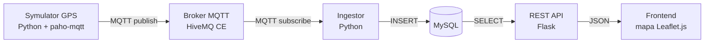

# System zarządzania flotą pojazdów

Projekt zaliczeniowy z przedmiotu *Python w zastosowaniach IT* (Wydział Mechatroniki PW, temat nr 12).

Pojazdy firmowe wysyłają swoją pozycję GPS przez **MQTT**. System zapisuje ją w **bazie danych**, udostępnia przez **REST API** i pokazuje na mapie w czasie rzeczywistym. Pojazdy są symulowane programem w Pythonie. Całość działa w **Dockerze**.

## Architektura



Droga jednej wiadomości: symulator wysyła pozycję pojazdu na topic MQTT, broker przekazuje ją ingestorowi, ten zapisuje ją w bazie, a API odczytuje ją z bazy na zapytanie mapy (co ok. 2 s).

## Technologie

| Element | Technologia |
|---|---|
| Symulator, ingestor, API | Python 3.14 |
| Broker MQTT | HiveMQ Community Edition |
| Baza danych | MySQL 8.4 |
| REST API | Flask |
| Frontend | HTML + JavaScript, Leaflet.js, OpenStreetMap |
| Uruchamianie | Docker, Docker Compose |

## Kontrakt (ustalony wspólnie, nie zmieniać bez zgody drugiej osoby)

### MQTT

- Topic: `fleet/vehicles/<vehicle_id>/gps`, QoS 1. Ingestor subskrybuje `fleet/vehicles/+/gps`.
- Payload (JSON):

```json
{"vehicle_id": 1, "ts": "2026-11-24T10:00:00Z", "lat": 52.2301, "lon": 21.0130, "speed_kmh": 47.5, "heading": 90}
```

`vehicle_id` to numer pojazdu z tabeli `vehicles` (nie tablica rejestracyjna), `ts` jest w UTC, `heading` to kierunek w stopniach (0 = północ, 90 = wschód).

### Baza danych

Schemat w [`db/init.sql`](db/init.sql):

- `vehicles(id, plate, name, model, status)`
- `positions(id, vehicle_id → vehicles.id, ts, lat, lon, speed_kmh, heading)`, z indeksem na `(vehicle_id, ts DESC)`

Czas `ts` w bazie to `DATETIME(3)` w **UTC** (bez strefy). Ingestor zapisuje go w UTC, a API zwraca w formacie ISO z literą `Z` (np. `2026-11-24T10:00:00Z`).

### REST API

| Endpoint | Opis |
|---|---|
| `GET /vehicles`, `POST /vehicles` | lista pojazdów, dodanie pojazdu |
| `GET /vehicles/{id}`, `PUT /vehicles/{id}`, `DELETE /vehicles/{id}` | odczyt, zmiana, usunięcie pojazdu |
| `GET /positions/latest` | ostatnia pozycja każdego pojazdu (dla mapy) |
| `GET /vehicles/{id}/history?from=&to=` | historia pozycji pojazdu |

## Struktura repozytorium

```
db/          schemat bazy (init.sql)
simulator/   symulator pojazdów (Python)
ingestor/    odbiera wiadomości z MQTT i zapisuje do bazy
api/         REST API (Flask)
frontend/    mapa (HTML + JS)
docs/        slajdy, diagramy, dokumentacja
docker-compose.yml
```

## Uruchomienie

Wymagany jest Docker Desktop. Do pracy lokalnej w PyCharmie używamy Pythona 3.14.

```
docker compose up --build
```

To uruchamia broker, bazę i symulator. Co sprawdzić:

- **Logi symulatora:** `docker compose logs -f simulator` (co sekundę wiadomość "wysłano 5 pozycji").
- **Wiadomości MQTT na żywo:** w programie MQTTX albo MQTT Explorer połącz się z `localhost`, port `1883`, i subskrybuj `fleet/#`.
- **Baza:** w DBeaverze lub MySQL Workbench połącz się z `localhost:3306`, baza `fleet`, użytkownik `fleet`, hasło `fleet_dev_pass` (tylko do lokalnego developmentu).

Zatrzymanie: `docker compose down` (dane w bazie zostają). Z opcją `-v` kasuje też bazę, co jest potrzebne po zmianie `db/init.sql`, bo ten plik wykonuje się tylko przy pierwszym starcie z pustą bazą.

Własne hasła ustawia się w pliku `.env` (wzór: `.env.example`). Plik `.env` nie trafia na GitHub.

## Podział prac

- **Osoba A** (dane i infrastruktura): docker-compose, broker, symulator, ingestor, schemat bazy.
- **Osoba B** (API i frontend): Flask, endpointy, mapa Leaflet.
- **Wspólnie:** architektura, README, slajdy, testy integracyjne, review Pull Requestów.

Praca na osobnych branchach (`feature/...`), zmiany do `main` przez Pull Request zatwierdzany przez drugą osobę.

## Status

- [x] Szkielet repozytorium, docker-compose (broker + baza), schemat bazy, symulator
- [ ] Ingestor (MQTT → baza)
- [ ] REST API
- [ ] Mapa na żywo
- [ ] Testy i dokumentacja
